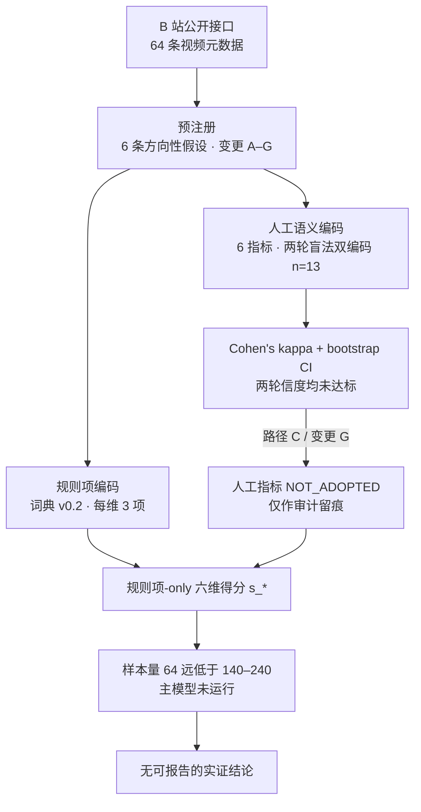

# SUCCES on Bilibili · 预注册的内容特征测量与关联研究（系列整合仓库）

[English version](README.en.md) · [网页版（约 3 分钟）](index.html) · [整合报告](REPORT.md) · [主体 SK_](studies/SK_/) · [延伸 SW_](studies/SW_/) · [复现与发布指南](docs/REPRODUCE.md)

> **本仓库收录三项独立研究的可公开代码、预注册与聚合结果，共用一个编码表与「先定测量、再看结果」的口径。**
>
> | 阶段 | 位置 | 状态 | 结论 |
> |---|---|---|---|
> | 前序 `SC_` | 根目录 `R/`、`SC_*.py` | 64 条自采视频；主观语义指标两轮双编码未达标后主动排除；主模型因样本量不足**从未运行** | **不报告任何实证发现** |
> | 主体 `SK_` | [`studies/SK_/`](studies/SK_/) | 两份许可明确的 Kaggle 数据集，预注册后运行主模型 | **1 / 6** 获支持：H3 Concrete β=+0.0891、q=0.0292、95% CI [+0.0274, +0.1508]；去掉账号层控制后不显著、换领域未复现 |
> | 延伸 `SW_` | [`studies/SW_/`](studies/SW_/) | 每周必看高赞热评，换构念层级 | **0 / 6** 检出正相关；显式学习表述仅 13 / 2,773，原构念近乎不可测 |
>
> 三项样本框、数据源与分析单位不同，**未合并、未互证**；全篇只作关联解释，不写因果、不写「SUCCES 有效 / 无效」。完整叙述见 [网页版](index.html) 与 [REPORT.md](REPORT.md)。

---

## 1. 这个仓库有什么、没有什么

| | 内容 |
|---|---|
| ✅ 有 | 64 条真实公开视频元数据；预注册与 7 条口径变更记录（A–G）；编码手册 v0.3；可复现的词典/正则编码；两轮盲法 20% 双人编码的判定结果与审计文档；Cohen's kappa + bootstrap CI 报告；全链路自检 **11/11 PASS**；`studies/` 下 `SK_` / `SW_` 的脚本、预注册与聚合结果表 |
| ❌ 没有（`SC_` 部分） | 运行过的主模型；`SC_` 部分的任何效应估计、p 值、置信区间或因果结论；字幕数据（覆盖率 0%）；可外推到其它平台的研究发现 |
| ❌ 没有（全仓库） | 评论正文、个体级编码表、双编码交回原件、原始 zip、任何认证凭据或用户个人信息 |

`SC_` 部分是一个「把测量失败完整留痕、并据此缩小口径」的案例；要看关联结果，请进 [`studies/SK_/`](studies/SK_/) 与 [`studies/SW_/`](studies/SW_/)，或先看 [3 分钟网页版](index.html)。

## 2. 研究问题

《Made to Stick》(Chip & Dan Heath, 2007) 提出的 **SUCCES 六法则**——Simple / Unexpected / Concrete / Credible / Emotional / Stories——是一套用于提升信息传播效果的理论框架。本项目把它放进 B 站知识区的真实场景，问三个问题：六个维度各自与互动表现如何关联、控制账号体量后是否仍稳健、硬核科普与通识内容是否存在异质性。

**H1–H6 全部预设为正相关，方向在看数据之前冻结**（[预注册](docs/SC_preregistration.md)），目的是避免事后找故事。

一个关键设计决定：**因变量是互动率，不是播放量**。播放量主要是推荐算法分发的结果，用它当「传播效果」会混淆内容特征与平台流量分配；互动率 `(点赞+投币+收藏+分享+评论)/播放` 更接近受众反应，模型里另外控制粉丝量与时长。

## 3. 方法链



## 4. 核心决定：路径 C

| 轮次 | 做法 | 结果 | 处理 |
|---|---|---|---|
| 第一轮 | coderA 由脚本代填（流程演示）+ 真人 coderB | 判定边界模糊、出现常量边际 | 数据不导入主模板，原件归档；修订手册至 v0.3 |
| 第二轮 | A / B 两位真人各持一份盲法表，按 v0.3 独立重编同一 13 条 | 正式 kappa 未达预注册目标，无任何指标 CI 下限 > 0；两位编码人松紧尺度方向相反 | 导入并出具正式报告，但判定信度不足 |

**结论：六个人工语义指标正式不采用**（`s1 / u3 / c3 / cr1 / st3 / e4` → `*_NOT_ADOPTED`），不进入得分、不进入模型、不作为成果。六维得分改为**规则项-only**；含人工项的混合口径另存 `*_DIAGNOSTIC_ONLY`，仅供覆盖度诊断。Codebook 冻结在 v0.3，不再重编。

> 为什么值得记录：n=13 的 CI 宽度不会因再编一轮改变，继续加人工是在用更多投入修一个校准问题。在看到任何回归结果之前就主动放弃一个不可靠的测量，比事后挑一个好看的系数更接近研究设计本身。完整推理与前置条件见 [docs/SC_coding-adoption.md](docs/SC_coding-adoption.md)，两轮诊断见 [round1](docs/SC_coderB_round1.md) / [round2](docs/SC_coderB_round2.md)。

⚠️ [`output/SC_kappa_report.txt`](output/SC_kappa_report.txt) 是**审计证据**，用于说明「为什么不采用」，不是一致性达标的证明。不得从中摘取单指标点估计当作成果。仓库内 `SC_kappa_demo_SIMULATED.csv` 只用于验证公式实现，文件名已标注 SIMULATED，其数值与任何真实一致性无关。

## 5. 数据

| 项 | 值 |
|---|---|
| 样本 | **64 条**真实公开视频；「社科·法律·心理」(`rid=124`) 30 条 +「科学科普」(`rid=201`) 34 条 |
| 抽样 | 子区 × 热度层 × 主题层分层；目标 120 条，实收 64 条，缺口 56 **不补造、不扩区** |
| 可用样本标记 | `view_usable` / `analysis_eligible` = 48；`view ≥ 1000` 的 `rate_stable` = 41；`within_1yr` = 27（仅作敏感性标记） |
| 素材 | 标题 + 简介（`desc` 覆盖 56%）；**字幕覆盖率 0%**，`u4` 标 NA 而不冒充 0 |
| 时间口径 | 榜单为 2025-04 历史快照（约 580 天）；`day` 是排行榜统计窗口而非投稿时间，**时间不做强制要求**，快照窗口纳入口径并写进局限 |
| 数据源 | 仅 B 站公开接口；核查过但**未使用** Kaggle / 和鲸现成数据集（[核查记录](docs/SC_alt-datasets.md)） |

**合规**：只采集公开视频元数据，不取用户个人信息、不存评论正文、不提交任何 cookie / token / 登录态；请求带间隔，`-352` / `-799` 等风控响应一律跳过而非绕过。字段字典见 [docs/data-source.md](docs/data-source.md)。

双编码的**交回原件与导入前备份不随公开仓库分发**（仅本地工作区留存）；仓库只保留判定汇总 `SC_manual_coding.csv`、`SC_double_coding_template.csv` 与正式报告 `output/SC_kappa_report.txt`。两轮流程与校准漂移诊断见 [round1](docs/SC_coderB_round1.md) / [round2](docs/SC_coderB_round2.md)；文档中出现的 `handoff/` 路径为流程留痕，不代表仓库内文件。编码人仅以代号 (`R2` / `coderB`) 出现。

## 6. 快速复现

两个核心 R 脚本**只依赖 base R**，不需要安装任何包，也不需要联网：

```bash
git clone https://github.com/fsq1815/succes_research.git && cd succes_research

# SC_ · 前序（仅 base R，不联网、不装包）
Rscript R/SC_mvp.R      # 规则项-only 编码 + 11 项自检
Rscript R/SC_kappa.R    # 正式 kappa + bootstrap CI

# SK_ · 主体（原始数据按 manifest 重建，不随仓库分发）
cd studies/SK_ && python3 SK_download.py && python3 SK_prepare.py && Rscript R/SK_analyze.R

# SW_ · 延伸（评论正文不分发；只读复现见 studies/SW_/docs/SW_reproduce.md）
cd ../SW_ && python3 SW_prepare.py && Rscript R/SW_analyze.R
```

预期：`11 / 11 PASS`，且自检明含「人工指标未进入分析口径」。Python 侧只依赖标准库；如需重跑表格导出/校验，另装 `openpyxl`，如需重跑采集，另需系统 `curl`。从头采集会打真实接口并**覆盖** `data/raw/` 下的现存样本，不建议在只读复现时运行。完整的脚本副作用矩阵、依赖说明与故障排查见 [docs/REPRODUCE.md](docs/REPRODUCE.md)。

⚠️ 以下脚本是历史留痕，**不要重跑**，否则会覆盖已归档的真人编码判定、破坏审计链：`SC_make_coding_sheets.py`、`SC_fill_coderA.py`、`SC_export_coderB.py`、`SC_import_coderB.py`、`SC_sync_coderA_to_main.py`。

## 7. 目录结构

```
├── README.md / README.en.md        项目说明（中 / 英）
├── index.html                      ⭐ 网页版系列整合叙述（GitHub Pages 首页，自包含无外链）
├── REPORT.md                       ⭐ 系列整合报告（主体 SK_ + 延伸 SW_ + 前序 SC_）
├── LICENSE / CITATION.cff          许可与引用
├── docs/
│   ├── SC_coding-adoption.md       ⭐ 路径 C 决策：测量采用性的单一权威口径
│   ├── SC_preregistration.md       六条方向性假设、分析方案、变更 A–G
│   ├── codebook.md                 SUCCES 六维编码手册 v0.3（含判定细则与 Changelog）
│   ├── data-source.md              接口、字段字典、抽样与合规
│   ├── SC_sample-scope.md          抽样框上限、时间语义核对、解锁条件
│   ├── SC_pilot.md / SC_mvp.md     pilot 28 → 33 → 64 条三轮试跑记录
│   ├── SC_coderB_round1.md         第一轮回收体检与规则修订
│   ├── SC_coderB_round2.md         第二轮正式 kappa、校准漂移诊断、路径 C 决策
│   ├── SC_alt-datasets.md          外部数据集核查（最终未采用）
│   └── REPRODUCE.md                复现、发布与隐私检查清单
├── SC_*.py                         采集 / 接口体检 / 盲法编码表 / 交回校验（历史留痕）
├── R/
│   ├── SC_mvp.R / SC_kappa.R       ⭐ 两个可独立复跑的核心脚本（仅 base R）
│   ├── SC_pilot.R                  pilot 链路自检
│   ├── 00_setup.R / 01_collect.R / 02_code_succes.R / 03_eda.Rmd / 04_model.Rmd
│   │                               报告层骨架，**预定分析方案，尚未渲染**
├── studies/
│   ├── SK_/                        ⭐ 主体：脚本、预注册、方法文档、output/ 聚合结果
│   └── SW_/                        ⭐ 延伸：脚本、预注册、方法文档、output/ 聚合结果
├── data/raw/                       公开视频元数据 + 请求审计日志（SC_ 复现输入）
├── data/processed/                 编码结果与双编码判定汇总（交回原件不分发）
├── output/                         自检报告、kappa 报告、采集报告
└── writeup/report.Rmd              未渲染的报告模板（含状态横幅与 `___` 占位，非成品报告）
```

## 8. 局限（不是免责声明，是研究判断）

1. **样本量**：64 条，主模型需约 140–240 条观测，故从未运行；`s_credible` / `s_stories` 在规则项口径下变异稀疏。
2. **构念效度**：口径收缩后每维由 4 项减为 3 项；测的是标题与简介的**文本特征**，不是「法则本身」，更不是内容质量。字幕 0% 使 Stories 只能靠标题代理，`s4` 在本样本为常量。
3. **算法内生性**：互动率仍受推荐流、封面、流量池与粉丝活跃度影响，且存在反向因果（运营会依数据改标题）。全篇只做关联解释。
4. **外部效度**：单平台、中文语境、单一历史快照窗口，结论不能外推到其它平台或内容形态。
5. **测量信度**：人工语义编码两轮均未达标并已排除；这是口径的代价，不是被掩盖的缺陷。

## 9. 引用边界

> 下表约束的是 **`SC_` 前序部分**。`SK_` / `SW_` 各自可／不可声称的边界见 [`studies/SK_/SK_report.md`](studies/SK_/SK_report.md) 与 [`studies/SW_/SW_report.md`](studies/SW_/SW_report.md)；跨项目陈述一律标注来源。

| ✅ 可以写 | ❌ 不得写 |
|---|---|
| 64 条真实公开视频、锁定两区、预注册、codebook v0.3、两轮盲法 20% 双编码流程 | 「编码一致性达标」「kappa 良好」，或摘取任何单个 kappa 数值当作成果 |
| 「发现主观语义指标信度不足，主动排除出分析口径，只保留可复现规则项」这一研究设计判断 | `modelled each dimension against engagement rate`、`240 videos`、`cluster-robust SE` 等未发生的产出 |
| 字幕 0%、榜单历史快照、120 条目标未达、主模型因样本量不足未运行 | 就 `SC_` 部分报告任何回归系数、p 值、置信区间、因果结论，或「SUCCES 有效 / 无效」 |
| 跨项目陈述见 [整合报告](REPORT.md)，须标注各自项目来源；系数由 `studies/` 下各自 R 脚本产出 | 把 `SK_` / `SW_` 系数读成 `SC_` 的产出、说成复现 / 合并样本，或用延伸结论反推 `SC_` 的主模型结果 |

## 10. 许可

代码按 [MIT](LICENSE) 发布；`studies/SK_/` 与 `studies/SW_/` 各自附来源与许可声明。本仓库只发布脚本、文档与聚合结果：`data/raw/` 为公开视频元数据（含创作者公开标识），不含观众个人信息；评论正文、个体级编码表、Kaggle 原始 zip 与双编码交回原件一律不分发，由各自下载 / 采集脚本按 manifest 重建。`SW_` 数据源许可 Unknown，故只发布聚合统计。SUCCES 框架引自 Chip Heath & Dan Heath《Made to Stick》(2007)，仅作学术分析对象，权利归原作者。

## 11. 仓库地址与网页版

- 代码仓库：<https://github.com/fsq1815/succes_research>
- 网页版（约 3 分钟）：<https://fsq1815.github.io/succes_research/>

克隆后即可复现，无需额外配置：

```bash
git clone https://github.com/fsq1815/succes_research.git && cd succes_research
```

本仓库的分析与结论走两条通道：`R/` 下的 `SC_` 脚本与 `studies/` 下 `SK_` / `SW_` 的脚本、预注册、聚合结果；`index.html` 与 `REPORT.md` 只负责叙述，不产生新数字。若你要基于本仓库做 GitHub Pages 之类的二次发布，请先读 [docs/REPRODUCE.md](docs/REPRODUCE.md) 末节的发布自检清单。
